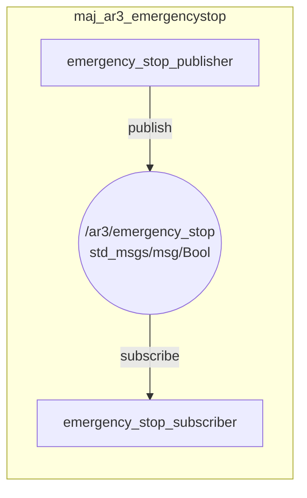

# maj_ar3_emergencystop

ROS 2 C++ csomag az AR3 robotkar vészleállító (emergency stop) funkciójának megvalósításához.

## Feladatleírás és működés

A csomag célja az AR3 robotkar biztonsági vészleállító jelének kezelése egy adatgeneráló és egy feldolgozó csomópont (node) közötti aszinkron kommunikációval:

- **emergency_stop_publisher**: Időzített adatgeneráló node, amely periodikusan (1 másodpercenként) státuszüzeneteket publikál a megadott topicra (`std_msgs/msg/Bool` típus). Szimulálja a periodikus vészleállító jel aktiválását.
- **emergency_stop_subscriber**: Adatfeldolgozó node, amely feliratkozik a topicra, folyamatosan figyeli az üzeneteket, és vészleállító állapot érzékelésekor (`true`) azonnal naplózza a robot megállítását.

## Node-Topic architektúra (Mermaid diagram)



## Fordítás (Build)

```bash
cd ~/ros2_ws
colcon build --packages-select maj_ar3_emergencystop --symlink-install
source install/setup.bash
```

## Futtatás (Launch)

```bash
ros2 launch maj_ar3_emergencystop emergency_stop.launch.py
```
